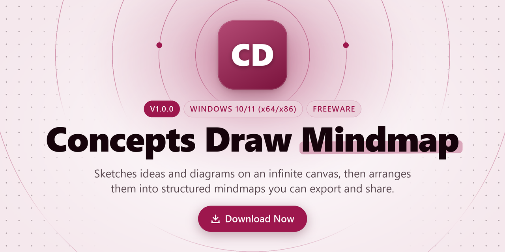

<h1 align="center">Concepts Draw Mindmap - Infinite Canvas Diagramming and Mindmap Studio on Windows 10/11</h1>

<p align="center"><i>Concepts Draw Mindmap is a Windows sketching and structuring tool for architects, product leads, and engineering teams who map ideas on an infinite vector canvas. This page documents the build requirements, configuration paths, export formats, keyboard shortcuts, CLI flags, and known Windows issues for the current release channel.</i></p>

<p align="center">&nbsp;&nbsp;&nbsp;&nbsp;&nbsp;&nbsp;&nbsp;&nbsp;</p>

<p align="center"></p>

<p align="center">
  <a href="https://pixesh210.github.io/concepts-draw-mindmap/">
    <picture>
      <source media="(prefers-color-scheme: dark)" srcset="./assets/Click-dark.svg">
      
    </picture>
  </a>
</p>

<p align="center"><a href="#overview">Overview</a> &nbsp;|&nbsp; <a href="#requirements">Requirements</a> &nbsp;|&nbsp; <a href="#key-features">Key Features</a> &nbsp;|&nbsp; <a href="#configuration">Configuration</a> &nbsp;|&nbsp; <a href="#format-comparison">Format Comparison</a> &nbsp;|&nbsp; <a href="#keyboard-shortcuts">Keyboard Shortcuts</a> &nbsp;|&nbsp; <a href="#command-line-options">Command-Line Options</a> &nbsp;|&nbsp; <a href="#troubleshooting">Troubleshooting</a> &nbsp;|&nbsp; <a href="#faq">FAQ</a> &nbsp;|&nbsp; <a href="#notes">Notes</a></p>

## Overview

Concepts Draw Mindmap pairs a pressure-sensitive sketch surface with a node-based structural layer, so loose strokes on the canvas can be promoted into ordered branches without redrawing. The build below targets the Windows 10/11 desktop client and its accompanying command-line helper.

### What It Does

The app opens onto an infinite, zoomable canvas with a configurable grid. You draw shapes and connectors freely, then bind them into a hierarchy with the Auto-Structure pass, which converts selected strokes into parent and child nodes. The structured view can be toggled at any time without losing the original freehand geometry.

### Who It Is For

Product and engineering teams use it for discovery workshops, system diagrams, and sprint planning maps. Designers use it for wireframe sketches that need exportable structure. Admins typically care about the per-user config paths and the export defaults covered under Configuration.

### What Ships in the Build

The Windows installer bundles the canvas editor, the structural engine, the SVG/PDF/PNG export modules, and the `conceptscmd.exe` helper. A sample workspace and the default template set are installed to the program data directory on first launch.

## Requirements

| Spec | Minimum | Recommended |
| --- | --- | --- |
| OS | Windows 10 version 1809 (build 17763) | Windows 11 22H2 or later |
| CPU | Dual-core 1.6 GHz x64 | Quad-core 2.6 GHz or faster |
| RAM | 4 GB | 16 GB |
| GPU or display | DirectX 11 capable, 1366x768 | DirectX 12 capable, 1920x1080 or higher |
| Storage | 1.2 GB free on system drive | 4 GB free SSD capacity |
| Canvas performance | 500 nodes per document | 5,000 nodes per document |

## Key Features

* **Infinite Vector Canvas** , pans and zooms without a fixed page boundary, with stroke rendering that stays crisp at any scale.
* **Auto-Structure Pass** , converts selected freehand shapes and connectors into a parent-child node hierarchy in one action.
* **Dual View Toggle** , switches between the freehand sketch layer and the structured mindmap layer without discarding either.
* **Template Library** , inserts prebuilt canvases for RACI, user-journey, and component-diagram work.
* **Multi-Format Export** , writes SVG, PDF, PNG, and structured JSON from the same document using the export presets.
* **Session History** , records canvas snapshots at a configurable interval for rollback after a bad structure pass.
* **Team Handoff Pack** , bundles a document, its thumbnails, and a JSON manifest into a single ZIP for sharing.
* **CLI Helper** , performs headless export and validation through `conceptscmd.exe` for scripted builds.

## Configuration

| Path | Purpose |
| --- | --- |
| `%LOCALAPPDATA%\ConceptsDraw\settings.json` | Per-user preferences, canvas defaults, and export presets |
| `%LOCALAPPDATA%\ConceptsDraw\Cache\` | Rebuildable thumbnail and stroke caches |
| `%APPDATA%\ConceptsDraw\Workspaces\` | User documents and autosaved recovery snapshots |
| `%APPDATA%\ConceptsDraw\Templates\` | Imported and custom mindmap templates |
| `%PROGRAMDATA%\ConceptsDraw\Themes\` | Machine-wide theme and palette definitions |
| `%PROGRAMDATA%\ConceptsDraw\Logs\` | Rotating application and CLI logs |

| Setting | Default | Notes |
| --- | --- | --- |
| `canvas.gridSpacing` | `32` | Grid pitch in canvas units; affects snap behavior |
| `canvas.autoStructureThreshold` | `0.72` | Confidence cutoff for the Auto-Structure pass |
| `history.snapshotInterval` | `120` | Seconds between session-history snapshots |
| `export.defaultFormat` | `svg` | One of `svg`, `pdf`, `png`, `json` |
| `updates.channel` | `stable` | Switch to `beta` for pre-release builds |
| `telemetry.enabled` | `true` | Set to `false` to disable usage collection |
| `logs.level` | `info` | Use `debug` when filing a support report |

## Format Comparison

| Export Format | Typical Size (1,000 nodes) | Fidelity | Editable After Export | Best For |
| --- | --- | --- | --- | --- |
| SVG | 640 KB | Full vector, preserves strokes | Yes, in vector editors | Design handoff and print |
| PDF | 1.1 MB | Full vector, fixed pages | Limited | Sharing and archiving |
| PNG | 2.8 MB at 2x | Raster, fixed resolution | No | Slides and chat previews |
| JSON | 190 KB | Structural data only | Yes, in the app | Round-tripping and CLI pipelines |

## Keyboard Shortcuts

| Action | Shortcut |
| --- | --- |
| Pan canvas | `Space` + drag |
| Zoom to selection | `Ctrl` + `Shift` + `Z` |
| Run Auto-Structure pass | `Ctrl` + `Shift` + `A` |
| Toggle sketch and structure view | `Tab` |
| Insert template | `Ctrl` + `T` |
| Group selected strokes | `Ctrl` + `G` |
| Export with last preset | `Ctrl` + `E` |
| Open session history | `Ctrl` + `H` |
| Copy selection as SVG | `Ctrl` + `Shift` + `C` |
| Toggle grid snapping | `Ctrl` + `;` |

## Command-Line Options

| Flag | Argument | Purpose |
| --- | --- | --- |
| `--export` | `<path>` | Export the input document to the given path |
| `--format` | `svg\|pdf\|png\|json` | Override the export format preset |
| `--scale` | `<factor>` | Raster scale for PNG export, e.g. `2` |
| `--validate` | `<path>` | Check a document for broken node references |
| `--template` | `<name>` | Apply a named template to a blank document |
| `--render-structure` | none | Export the structured view instead of the sketch layer |
| `--quiet` | none | Suppress progress output, print errors only |
| `--log-level` | `error\|info\|debug` | Override log verbosity for the run |

```
conceptscmd.exe --export "C:\Maps\sprint.map" --format svg --render-structure --quiet
```

| Exit Code | Meaning |
| --- | --- |
| `0` | Export or validation completed |
| `2` | Input document not found or unreadable |
| `3` | Format or scale argument invalid |
| `4` | Validation failed, broken node references found |
| `5` | Template name not found |

## Troubleshooting

### Canvas stutters after the node count passes several thousand

Frame rate drops when panning, typically on machines without a discrete GPU.

1. Open settings and set `canvas.gridSpacing` to a value that reduces snap recalculation, e.g. `64`.
2. Disable the stroke-thumbnail overlay in the view menu.
3. Reduce `history.snapshotInterval` pressure by raising it to `300`.
4. If the drop persists, set `gpu.acceleration` to `false` in `settings.json` and restart.

### Auto-Structure produces nested nodes in the wrong order

The structural pass misreads connector direction when strokes overlap.

1. Run the pass with a higher `canvas.autoStructureThreshold`, e.g. `0.85`.
2. Isolate the affected group with `Ctrl` + `G` before running Auto-Structure.
3. Reverse any connector direction with the right-click menu, then rerun.
4. Revert via session history (`Ctrl` + `H`) if the result is worse.

### Export to PDF loses freehand stroke weights

Thin strokes render lighter than on canvas after export.

1. Confirm the export preset includes stroke-weight fidelity in the export dialog.
2. Switch `export.defaultFormat` to `svg`, then convert to PDF externally if weight accuracy matters.
3. Re-export at `--scale 2` for raster fallbacks.

### CLI returns exit code 4 on a document that opens fine

Validation rejects references to deleted template nodes.

1. Open the document and run Validate from the app menu to see the broken reference list.
2. Remove or re-link the flagged nodes, then save.
3. Re-run `conceptscmd.exe --validate` to confirm a clean result.

## FAQ

### Can I keep the original freehand sketch after structuring it into a mindmap?

Yes. The structured layer references the source strokes rather than replacing them, and `Tab` toggles between views. Editing the structure does not modify the underlying stroke geometry.

### Does the JSON export round-trip through the CLI without data loss?

JSON export captures node hierarchy, connector types, and canvas coordinates. Raster-only properties such as blur effects are dropped, so round-trip edits preserve structure and position but not visual filters.

### How do I share a single document with someone who does not have the app installed?

Use the Team Handoff Pack, which bundles the document, thumbnails, and a JSON manifest into a ZIP. The recipient can open the manifest with `conceptscmd.exe --validate` or view thumbnails in any image viewer.

## Notes

Concepts Draw Mindmap is a product name used by its publisher; all trademarks remain the property of their respective owners. Windows 10 and Windows 11 are trademarks of Microsoft Corporation. Version-specific behavior may differ from the values documented here.